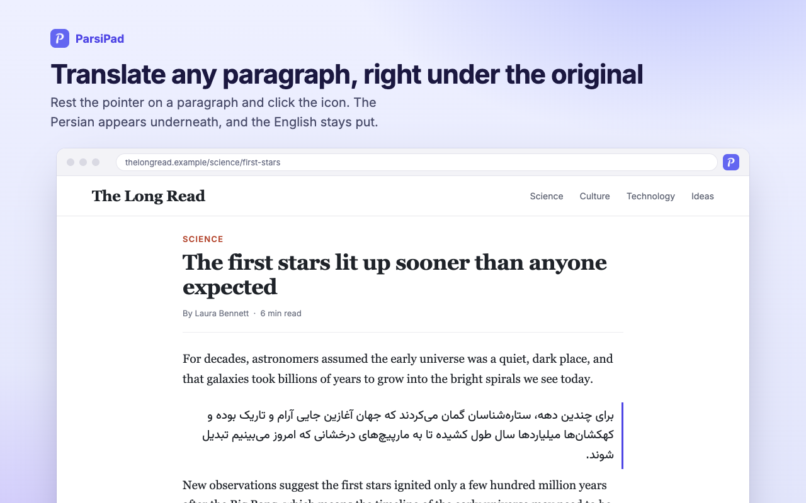
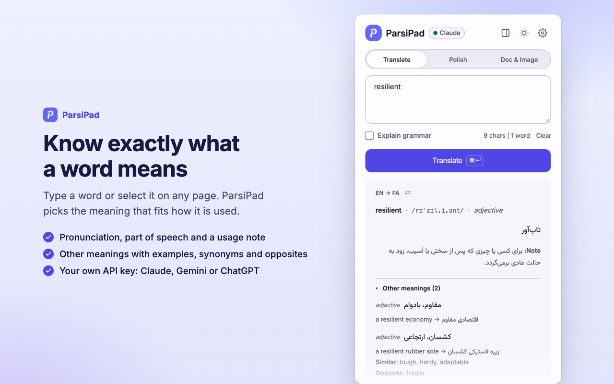

<p align="center">
  
</p>

<h1 align="center">ParsiPad</h1>

<p align="center">
  <strong>AI-powered Persian ↔ English translator for Chrome and Firefox.</strong>
  <br>
  Translate, look up, polish and learn, with your own Claude, Gemini or ChatGPT key.
</p>

<p align="center">
  <a href="https://chromewebstore.google.com/detail/parsipad-persian-english/kmifhjlofnblfogkjjcmhlmcecghhfbp"></a>
  <a href="https://chromewebstore.google.com/detail/parsipad-persian-english/kmifhjlofnblfogkjjcmhlmcecghhfbp"></a>
  <a href="https://addons.mozilla.org/firefox/addon/parsipad/"></a>
  <a href="https://addons.mozilla.org/firefox/addon/parsipad/"></a>
  <a href="https://github.com/amirehsan/parsipad/actions/workflows/ci.yml"></a>
  <a href="https://github.com/amirehsan/parsipad/actions/workflows/codeql.yml"></a>
  <a href="LICENSE"></a>
</p>

<p align="center">
  <a href="https://chromewebstore.google.com/detail/parsipad-persian-english/kmifhjlofnblfogkjjcmhlmcecghhfbp">Install for Chrome</a> ·
  <a href="https://addons.mozilla.org/firefox/addon/parsipad/">Install for Firefox</a> ·
  <a href="https://parsipad.com">Website</a> ·
  <a href="docs/USER_GUIDE.md">User guide</a> ·
  <a href="CHANGELOG.md">Changelog</a> ·
  <a href="PRIVACY.md">Privacy</a> ·
  <a href="docs/VERIFY.md">Verify it yourself</a>
</p>

<p align="center">
  
</p>

## Contents

- [Why ParsiPad](#why-parsipad)
- [Features](#features)
- [Installation](#installation)
- [Quick start](#quick-start)
- [Keyboard shortcuts](#keyboard-shortcuts)
- [Privacy and permissions](#privacy-and-permissions)
- [Development](#development)
- [Contributing](#contributing)
- [Security](#security)
- [License](#license)

## Why ParsiPad

- **Bring your own key.** Use Claude (Anthropic), Gemini (Google) or ChatGPT (OpenAI). There is no ParsiPad account and no server of ours in between: your text goes from your browser straight to the provider you chose.
- **Built for Persian.** Direction is detected automatically, Persian is laid out right to left wherever it appears, and the whole interface is available in English and فارسی.
- **Translation that reads the context.** A selected word or phrase is translated with the sentence around it in mind, so you get the meaning that fits.
- **More than a translator.** Grammar lessons written for Persian speakers learning English, a dictionary, three-way text polishing, flashcards and a searchable Library.

<p align="center">
  
  
</p>

## Features

### Translate anything on the page

- **Point to translate:** rest the pointer on a paragraph, post or heading and click the icon; the translation appears directly underneath while the original stays in place. `Alt+B` does the same from the keyboard.
- **Selection toolbar:** select text to get Translate, Polish, Dictionary and Mute buttons. Works with mouse, touch and keyboard, and in text boxes you type in, where Replace puts the result back.
- **Whole pages:** translate a page in place, with a cost estimate before it starts, progress as it goes, a toggle back to the original, and Retry for any section that failed.
- **Screenshot region:** drag a box around anything on screen, including images and text you cannot select, and translate what is inside.

### Work with text, files and words

- **Popup and side panel:** type or paste text to translate, or dock ParsiPad beside the page so it stays open while you browse.
- **Dictionary:** definitions by part of speech, IPA pronunciation, examples, synonyms and antonyms.
- **Polish:** rewrite your own text as Professional, Conversational or Concise, and regenerate any version.
- **Documents and images:** one drop zone for `.txt` files (up to 100 KB) and JPG, PNG or WebP images (up to 5 MB).

### Learn and keep what matters

- **Grammar:** explanations on any translation, plus full lessons with examples, compare-and-contrast notes, common mistakes and quizzes, written in English for Persian speakers learning it.
- **Library:** History, Favorites and saved Lessons in one searchable page, with Undo for deletes.
- **Practice and New Tab:** review favorites as flashcards, and see one of your saved words on every new tab.

### Made to live with

- Light, dark or system theme; settings on one page; JSON backup and restore; local caching of repeated lookups; a per-site mute list; and an Analytics page that estimates what you have spent per provider.

See the [user guide](docs/USER_GUIDE.md) for a walkthrough of every feature.

## Installation

### Chrome Web Store

Install ParsiPad from the [Chrome Web Store](https://chromewebstore.google.com/detail/parsipad-persian-english/kmifhjlofnblfogkjjcmhlmcecghhfbp). It works in a recent version of Google Chrome and should also install in other Chromium-based browsers that support Chrome Web Store extensions, such as Microsoft Edge and Brave.

### Firefox Add-ons

Install ParsiPad from [Firefox Add-ons](https://addons.mozilla.org/firefox/addon/parsipad/). It needs Firefox 140 or later on a desktop computer, and also installs in browsers built on Firefox, such as Zen, LibreWolf and Floorp. Its side panel opens in Firefox's sidebar.

### From source

Requires [Node.js](https://nodejs.org/) 20 or later (CI uses Node 20).

```bash
git clone https://github.com/amirehsan/parsipad.git
cd parsipad
npm ci
npm run build
```

`npm run build` writes the Chrome build to `dist/` and the Firefox build to `dist-firefox/`.

- **Chrome:** open `chrome://extensions`, turn on **Developer mode**, click **Load unpacked** and select the `dist/` folder.
- **Firefox:** open `about:debugging#/runtime/this-firefox`, click **Load Temporary Add-on** and select `dist-firefox/manifest.json`. Firefox removes a temporary add-on when it quits.

[CONTRIBUTING.md](CONTRIBUTING.md#building-from-source) describes the build in more detail.

## Quick start

1. **Get an API key** from one provider:

   | Provider | Where to get a key | Key starts with |
   | --- | --- | --- |
   | Claude (Anthropic) | [console.anthropic.com](https://console.anthropic.com/) | `sk-ant-` |
   | Gemini (Google) | [aistudio.google.com/apikey](https://aistudio.google.com/apikey) | `AIza` or `AQ.` |
   | ChatGPT (OpenAI) | [platform.openai.com/api-keys](https://platform.openai.com/api-keys) | `sk-` |

2. **Add it to ParsiPad.** The welcome page opens on first install. Choose your provider, paste the key and press **Save and test key**. ParsiPad makes one tiny real request and keeps the key only if it works. You can change the provider or key later in Settings.
3. **Translate.** Type in the popup and press `Ctrl+Enter` (`Cmd+Enter` on macOS), select text on a page and press `Alt+T`, or point at a paragraph and click the ParsiPad icon.

API usage is billed by your provider to your own account. Repeated lookups are served from a local cache at no cost.

## Keyboard shortcuts

| Shortcut | Action | Remappable |
| --- | --- | --- |
| `Alt+T` | Translate the selection | Yes |
| `Alt+D` | Look up the selection in the dictionary | Yes |
| `Alt+P` | Translate the whole page | Yes |
| `Alt+S` | Translate a screenshot region | Yes |
| `Alt+B` | Translate the paragraph at the pointer or keyboard focus | No |
| `Escape` | Close a ParsiPad box or stop a page translation | No |

Remap the first four at `chrome://extensions/shortcuts` in Chrome, or under Manage Extension Shortcuts in Firefox's Add-ons and themes page. All shortcuts are also listed in Settings > Shortcuts.

## Privacy and permissions

- Your API keys, settings, history, favorites and cache are stored only in your browser (`chrome.storage.local`).
- Text is sent only to the AI provider you chose, only when you ask for a translation, and only the part you asked about.
- To decide where to offer the translate icon, ParsiPad reads the page you are viewing locally; that text is never sent anywhere.
- No accounts, no telemetry, no tracking. The Analytics page is computed from local data and never leaves your device.
- You do not have to take this on trust. The store copies are reproducible from this source, a test fails if any code sends data anywhere but the provider APIs, and [docs/VERIFY.md](docs/VERIFY.md) shows how to check both yourself.

| Permission | Why it is needed |
| --- | --- |
| `storage` | Save settings, keys, history, favorites and the translation cache locally |
| `contextMenus` | Add the right-click menu entries |
| `activeTab`, `scripting` | Read the selection and show translation boxes on the tab you invoked ParsiPad on |
| `sidePanel` | Open ParsiPad in Chrome's side panel (Firefox uses its sidebar, which needs no permission) |
| `bookmarks` | Show your bookmarks (read only) in the New Tab drawer |
| `favicon` | Draw site icons from the browser's local cache, without an outside service (Chrome only; Firefox hands its cached icons over with `topSites`) |
| `topSites` (optional) | Show Most visited tiles on the New Tab, requested only when you turn that on |
| Host access to the three provider APIs | Send your requests to Anthropic, Google or OpenAI |

Read the full [privacy policy](PRIVACY.md).

## Development

ParsiPad is written in plain JavaScript (ES modules) on Manifest V3, with no UI framework. [esbuild](https://esbuild.github.io/) bundles it into `dist/` for Chrome and `dist-firefox/` for Firefox, from the same source, [Vitest](https://vitest.dev/) with happy-dom runs the tests, and [DOMPurify](https://github.com/cure53/DOMPurify) (vendored in `lib/vendor/`) sanitizes rendered output.

### Scripts

| Command | Description |
| --- | --- |
| `npm run build` | Production build of both browsers, into `dist/` and `dist-firefox/` |
| `npm run build:chrome`, `npm run build:firefox` | Production build of one browser |
| `npm run build:dev` | Unminified build with inline source maps |
| `npm run build:watch` | Development build that rebuilds on change (Chrome; add `-- --browser=firefox` for Firefox) |
| `npm test` | Run the unit tests once |
| `npm run test:watch` | Run the tests in watch mode |
| `npm run lint` | Lint with ESLint (`npm run lint:fix` to fix) |
| `npm run lint:firefox` | Check the Firefox build with Mozilla's `web-ext lint` |
| `npm run start:firefox` | Open Firefox with a clean profile and the Firefox build loaded |
| `npm run package` | Build both browsers and write the Chrome, Firefox and source zips for a release, with their SHA-256 sums |
| `npm run release` | Tag the packaged version and publish it as a GitHub release with its zips and sums (`-- --dry-run` to check first) |
| `npm run verify -- <path>` | Build from this checkout and compare it, file by file, with a store package or installed copy |
| `npm run clean` | Delete `dist/` and `dist-firefox/` |

During development, run `npm run build:watch`, load `dist/` as an unpacked extension, and press the reload icon on `chrome://extensions` after each rebuild. CI runs lint, tests and a build on every push and pull request to `main`, and CodeQL scans it for security problems.

### Project structure

```text
parsipad/
├── manifest.json        # Manifest V3 definition
├── background/          # Service worker: context menus, shortcuts, API calls
├── content/             # Content scripts: point-to-translate, selection toolbar, page translation
├── popup/               # Toolbar popup
├── sidepanel/           # Side panel
├── settings/            # Settings page
├── welcome/             # First-run onboarding
├── grammar/             # Grammar lesson page
├── library/             # History, Favorites and Lessons
├── practice/            # Flashcards
├── newtab/              # New Tab page
├── analytics/           # Usage and cost estimates
├── history/, favorites/ # Redirects from old pages to the Library
├── shared/              # UI pieces shared across pages
├── lib/                 # Core logic
│   ├── providers/       # Claude, Gemini and OpenAI clients
│   ├── translation/     # Translation pipeline: prompts, schemas, caching, budgets
│   ├── api.js           # Provider-agnostic API entry point
│   ├── constants.js     # Prompts and constants
│   ├── i18n.js          # English and Persian interface strings
│   └── vendor/          # Vendored third-party code
├── _locales/            # Manifest strings: name, description, menu and command labels
├── fonts/               # Bundled Inter and Vazirmatn fonts
├── icons/               # Extension icons
├── scripts/build.mjs    # esbuild pipeline
├── tests/               # Vitest unit tests
└── docs/                # User guide, design notes and images
```

## Contributing

Contributions are welcome. Read [CONTRIBUTING.md](CONTRIBUTING.md) and the [code of conduct](CODE_OF_CONDUCT.md), then open an [issue](https://github.com/amirehsan/parsipad/issues) or a pull request. Notable changes are recorded in the [changelog](CHANGELOG.md), which follows [Keep a Changelog](https://keepachangelog.com/en/1.0.0/) and [Semantic Versioning](https://semver.org/).

## Security

Please do not report vulnerabilities in public issues. See [SECURITY.md](SECURITY.md) for how to report one privately. To check a release yourself, see [docs/VERIFY.md](docs/VERIFY.md).

## License

[MIT](LICENSE)

## Acknowledgments

- AI by [Anthropic Claude](https://www.anthropic.com/), [Google Gemini](https://ai.google.dev/) and [OpenAI ChatGPT](https://openai.com/)
- Persian type set in [Vazirmatn](https://github.com/rastikerdar/vazirmatn) and Latin in [Inter](https://rsms.me/inter/)
- Built for the Persian-speaking community worldwide
